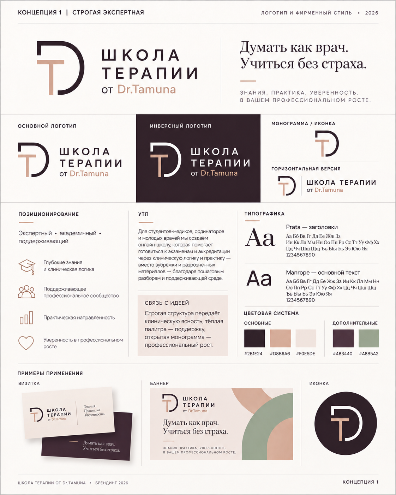

# Стартап в информационных технологиях

## Школа Терапии

**Работа:** первая неделя

**Тема:** название, слоган и уникальное торговое предложение

## Название и слоган

**Публичное название:** «Школа Терапии».

**Полная версия:** «Школа Терапии от Dr.Tamuna».

**Слоган:** «Думать как врач. Учиться без страха».

Название обозначает направление школы. Имя основателя связывает проект с преподавателем и его профессиональной репутацией. Слоган объединяет образовательную задачу и атмосферу обучения.

## Для кого создаётся проект

- Студенты-медики, которым нужна системная подготовка к государственным экзаменам и клиническим задачам.
- Ординаторы, которые готовятся к аккредитации и хотят связать теорию с практикой.
- Молодые врачи, которым важно увереннее рассуждать в клинических ситуациях.

Основная проблема аудитории — разрозненные знания: студент знает отдельные симптомы и определения, но затрудняется объяснить, как они связаны и как перейти к решению задачи.

## Уникальное торговое предложение

Для студентов-медиков, ординаторов и молодых врачей мы создаём онлайн-школу, которая помогает системно готовиться к государственным экзаменам и аккредитации и развивать клиническое мышление. Школа объясняет ход клинического рассуждения шаг за шагом, опирается на опыт практикующих врачей и создаёт безопасную среду для вопросов и разбора ошибок.

Предлагаемое отличие — сочетание клинической логики, практической подготовки и поддержки. Его значение для выбора школы следует проверять обратной связью учеников и сравнением с альтернативами.

## Позиционирование

- Клиническая логика вместо заучивания разрозненных ответов.
- Подготовка к экзаменам, аккредитации и решению клинических задач.
- Профессиональная и поддерживающая атмосфера, где не стыдно не знать.
- Онлайн-формат, совместимый с учёбой и дежурствами.

Школа обещает описанную образовательную услугу и поддержку. Гарантированная сдача экзамена не входит в обещание бренда.

## Визуальная айдентика

**Характер:** академичный, спокойный, экспертный и доброжелательный.

| Элемент | Решение |
|---|---|
| Основной тёмный цвет | Глубокий сливовый `#2B1E24` |
| Дополнительный тёмный цвет | Сливовый `#4B3440` |
| Акцент | Тёплый розово-бежевый `#D8B6A6` |
| Светлый фон | Мягкий тёплый белый `#F0E5DE` |
| Дополнительный акцент | Приглушённый зелёный `#A8B5A2` |
| Заголовки | Prata |
| Основной текст | Manrope |

## Брендбук

Брендбук содержит название и слоган, УТП, позиционирование, основной и инверсный варианты логотипа, монограмму `D / T`, типографику, цветовую систему и примеры применения на визитке, баннере и иконке.

## Результат работы

Сформулированы название, слоган, аудитория и ценностное предложение проекта. Брендбук задаёт общую визуальную основу сайта и учебных материалов.

[Следующая работа: неделя 2](../Week-2/README.md) · [Все работы](../README.md)
